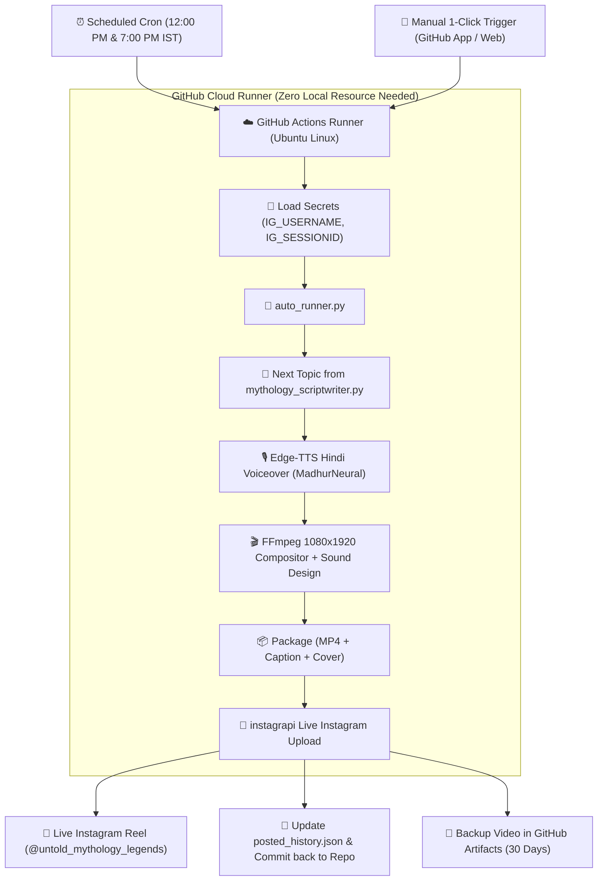

# 24/7 Cloud Automation Setup Guide (GitHub Actions) 🚀☁️

This setup allows your **Untold Mythology Instagram Reel Studio** to run autonomously **24 hours a day, 7 days a week**, generating and publishing viral Mahabharat reels even when your laptop is completely turned off or closed.

---

## 🏗️ Architecture Overview



---

## 📋 Step 1: Create Your Private GitHub Repository

1. Go to [github.com/new](https://github.com/new).
2. Set Repository name: e.g. `untold-mythology-automation`.
3. Choose **Private** (recommended to keep your project proprietary).
4. Click **Create repository**.

---

## 📋 Step 2: Link & Push Your Local Code to Your Repository

Run these commands in PowerShell inside `c:\Users\idea\OneDrive\Desktop\projects\instagram-agent-skill`:

```bash
# 1. Update the remote URL to your new repository
git remote set-url origin https://github.com/<YOUR_GITHUB_USERNAME>/untold-mythology-automation.git

# 2. Stage all automation files
git add .

# 3. Commit the autonomous engine
git commit -m "feat: 24/7 autonomous Instagram reels pipeline with GitHub Actions"

# 4. Push to main branch
git branch -M main
git push -u origin main
```

---

## 📋 Step 3: Add Your Instagram Credentials to GitHub Secrets

To keep your password and session cookie 100% secure:

1. In your GitHub repository, click **Settings** (top navigation bar).
2. On the left sidebar, click **Secrets and variables** $\rightarrow$ **Actions**.
3. Click the green button **New repository secret**.
4. Add the following 3 secrets:

| Secret Name | Value |
|---|---|
| `IG_USERNAME` | `untold_mythology_legends` |
| `IG_SESSIONID` | `80425933040%3AWgoyCBHLH8zDYM%3A24%3AAYkZpl0KH1w3lCJSWtrFKtrR-xSWG6y_Joy_tenolA` |
| `IG_PASSWORD` | *(Your Instagram password)* |

---

## 📋 Step 4: Enable Workflow Write Permissions

GitHub Actions needs permission to save the updated `posted_history.json` so it knows which reel was posted last:

1. In your repository, go to **Settings** $\rightarrow$ **Actions** $\rightarrow$ **General**.
2. Scroll down to **Workflow permissions**.
3. Select **Read and write permissions**.
4. Click **Save**.

---

## 🎯 How It Runs Autonomously

* **Scheduled Autopilot**: The workflow [.github/workflows/daily_reel_automation.yml](file:///c:/Users/idea/OneDrive/Desktop/projects/instagram-agent-skill/.github/workflows/daily_reel_automation.yml) is scheduled to run twice daily at peak Indian engagement times:
  * **12:00 PM IST** (`06:30 UTC`)
  * **07:00 PM IST** (`13:30 UTC`)
* **Manual On-Demand**: You can trigger a new reel anytime from your laptop or phone:
  1. Open your repo on GitHub $\rightarrow$ Click **Actions** tab.
  2. Click **24/7 Autonomous Instagram Reel Automation** on the left.
  3. Click **Run workflow** $\rightarrow$ Click green **Run workflow** button.
* **30-Day Video Backups**: Every generated video is automatically stored under the **Artifacts** section of each workflow run, allowing you to download the `.mp4` file directly to your phone or computer anytime.
